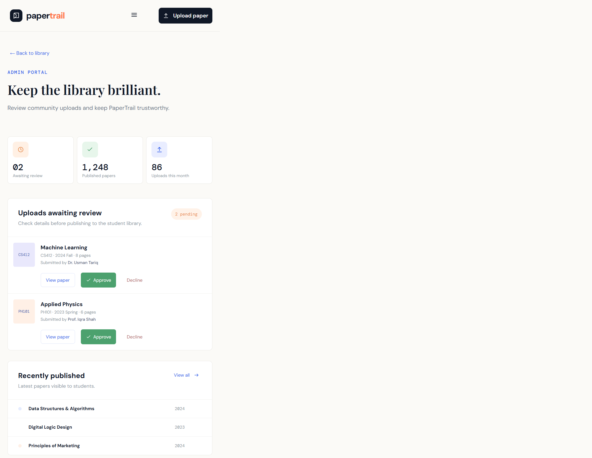

# PaperTrail

PaperTrail is a university past-paper library where students can discover,
search, share, and download trusted academic papers.

## Current status

Milestone 1 is complete:

- React and Vite frontend
- Express backend
- MongoDB connection setup
- API health endpoint
- CORS, Helmet, rate limiting, and error handling
- Responsive interactive demo interface
- Student library and admin portal screenshots

Paper search, authentication, uploads, moderation, and downloads will be
implemented in later milestones.

## Tech stack

- **Frontend:** React 18, Vite, JSX, CSS
- **Backend:** Node.js, Express, Mongoose
- **Database:** MongoDB

## Project structure

```text
PaperApp/
├── frontend/       # React/Vite application
├── backend/        # Express/MongoDB API
├── docs/            # Application screenshots
└── README.md
```

## Requirements

- Node.js 18 or newer
- MongoDB running locally or a MongoDB Atlas connection

## Run the project

### Backend

```powershell
cd backend
npm install
copy .env.example .env
npm run dev
```

The backend runs on `http://localhost:5000` by default.

### Frontend

Open a second terminal:

```powershell
cd frontend
npm install
copy .env.example .env
npm run dev
```

The frontend runs on `http://localhost:5173` by default. If that port is
occupied, Vite automatically selects another available port.

## Environment variables

### Backend

Configure `backend/.env`:

```env
PORT=5000
NODE_ENV=development
MONGODB_URI=mongodb://127.0.0.1:27017/papertrail
CLIENT_URL=http://localhost:5173
STORAGE_DIR=./storage
MAX_FILE_SIZE_MB=10
```

### Frontend

Configure `frontend/.env`:

```env
VITE_API_URL=http://localhost:5000
VITE_DEMO_MODE=false
```

## API health check

```text
GET http://localhost:5000/api/health
```

The response reports the API status and MongoDB connection status.

## Screenshots




## Validation

Build the frontend:

```powershell
cd frontend
npm run build
```

Validate the backend:

```powershell
cd backend
npm install
npm run dev
```

If MongoDB is unavailable, the backend exits with a clear connection error
instead of reporting a false healthy service.

## License

This project is intended for educational and university-library use.
